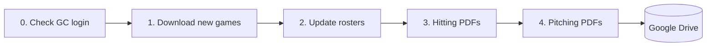

# WCWAA Scout


Scout builds **scouting reports** for Weddington youth baseball teams. It reads every game a team
has played on [GameChanger](https://web.gc.com) (GC), works out how each kid hits and pitches, and
turns that into printable PDF reports — one hitting report and one pitching report per team.

You can run it by clicking a button in a web page, from a simple menu, or let it run by itself
every day.

---

## Contents

1. [Where Everything Lives](#where-everything-lives)
2. [How Scout Works (Step by Step)](#how-scout-works-step-by-step)
3. [What's in the Reports](#whats-in-the-reports)
4. [Setting Up Scout on a New Mac](#setting-up-scout-on-a-new-mac)
5. [Running Scout](#running-scout)
6. [Teams, Seasons and Scrimmages](#teams-seasons-and-scrimmages)
7. [Analysis Tools (Minors / Majors extras)](#analysis-tools-minors--majors-extras)
8. [Troubleshooting](#troubleshooting)
9. [For Developers](#for-developers)

---

## Where Everything Lives

Scout keeps the **program** and the **reports** in two different places:

| What                                      | Where                                                                     | Why                                       |
| ----------------------------------------- | ------------------------------------------------------------------------- | ----------------------------------------- |
| **The program** (scripts, settings)       | On the Mac: `~/Documents/VSCode/Personal/Scout/`                          | Backed up to GitHub                       |
| **Reports + game data** (PDFs, workbooks) | Google Drive: `My Drive/Baseball/WCWAA/Scout/data/real/seasons/<season>/` | Syncs, so reports open on any phone or PC |
| **GameChanger login + run logs**          | On the Mac: `Scout/data/real/sessions/` and `Scout/data/real/logs/`       | Private; never shared or uploaded         |

Inside a season folder on Google Drive (example: `seasons/2026-Fall/`):

```
2026-Fall/
|-- Majors/Reports/  and  Minors/Reports/        <- league divisions
|   |-- Scouting_Reports/                         <- one Hitting + one Pitching PDF per team
|   |-- Scorebooks/                               <- downloaded games (one text file per game)
|   |-- rosters.json                              <- player names + jersey numbers
|   +-- *_Draft_Report_Card.pdf/.xlsx, *_Tournament_Futures_*.pdf,
|       *_Pitching_Usage_and_Team_Comparison.xlsx  <- Analysis Tools output
+-- Mavs/, Wild/ ...                              <- travel / tournament divisions
    +-- <Team Name>/
        |-- <Team>-Scout-Hitting_2026.pdf
        |-- <Team>-Scout-Pitching_2026.pdf
        |-- roster.txt
        +-- Games/                                <- downloaded games
```

---

## How Scout Works (Step by Step)

Every run does the same five things, in order:

| #   | Step                   | In plain terms                                                                                                                                                                                    |
| --- | ---------------------- | ------------------------------------------------------------------------------------------------------------------------------------------------------------------------------------------------- |
| 0   | **Check the login**    | Opens Scout's own Chrome window and makes sure GameChanger still recognizes you. If not, it skips downloading, still rebuilds the reports from games it already has, and tells you how to fix it. |
| 1   | **Download new games** | Looks at each team's GC schedule, finds finished games it doesn't have yet, and saves each game's play-by-play as a text file. Games already saved (or marked as scrimmages) are skipped.         |
| 2   | **Update rosters**     | Reads each game's box score to get every player's name and jersey number.                                                                                                                         |
| 3   | **Hitting reports**    | Goes through every at-bat, adds up each kid's stats, labels their hitting style, and draws the hitting PDF.                                                                                       |
| 4   | **Pitching reports**   | Goes through the same games from the pitcher's side, compares every pitcher with the rest of the division, and draws the pitching PDF.                                                            |



**Two kinds of divisions** (set per season):

| Type                    | Examples                  | Scout downloads…                          | Reports for…                       |
| ----------------------- | ------------------------- | ----------------------------------------- | ---------------------------------- |
| **League**              | Majors (11U), Minors (9U) | The whole league's schedule               | Every team in the league           |
| **Travel / Tournament** | Wild, Mavs, Storm         | Each team you've added, one schedule each | Each added team (ours + opponents) |

Active season: **2026 Fall** — Majors, Minors, Wild, Mavs.

**Why a Chrome window pops up:** GameChanger blocks hidden/automated browsers, so Scout uses a real
Chrome window with its own separate profile (your everyday Chrome is untouched). It sits off-screen
during Steps 1–2 and shows up as a second Chrome icon in the Dock — **don't close it**; it closes
itself when done.

---

## What's in the Reports

**Hitting report** (one card per kid, plus a team card and a summary page):

- **Stats** — AVG, OBP, SLG, how often they make contact, swing, swing-and-miss, and take the first pitch.
- **Spray chart** — where they hit the ball.
- **Hitter type** — two words: their **approach** (Aggressive / Passive / Disciplined) and their
  **result** (Power / Contact / Walker / Overmatched), compared with the rest of the league. A `*`
  means fewer than 10 plate appearances (use with care); `--` means fewer than 5.
- **How to pitch to them** — a one-line plan based on the hitter type (e.g. "Climb the Ladder").
- **LG RANK** — where the team ranks in the division on each stat (needs at least 2 teams).

**Pitching report** (Baseball Savant–style, 4 pitchers per page):

- 13 stats per pitcher (strikeouts, walks, contact allowed, ground balls, etc.).
- Each stat has a colored bar: **red = worse than most pitchers in the division, green = better**.
  The number in the bubble is the percentile (90 = better than 90% of pitchers).

---

## Setting Up Scout on a New Mac

You need:

- A **Mac** with **Google Chrome** installed in `Applications`.
- **Python 3.9 or newer** (check in Terminal: `python3 --version`).
- A **GameChanger account** that can see the teams you want to scout (staff or fan access).
- Access to the **GitHub repo** (it's private — ask the owner to add you).
- Optional: **Google Drive for Desktop**, if you want reports to sync to your phone.

### Step 1 — Download Scout

Open **Terminal** and run:

```bash
mkdir -p ~/Documents/VSCode/Personal && cd ~/Documents/VSCode/Personal
git clone https://github.com/mdesau/Scouting_Pipeline.git Scout
cd Scout
```

### Step 2 — Install what Scout needs

```bash
python3 -m venv venv               # a private Python just for Scout
source venv/bin/activate
pip install -r requirements.txt
pip install -e .
```

### Step 3 — Tell Scout where to save reports

Scout's default report folder is the owner's Google Drive. On any other Mac, pick your own folder
and add it to your shell profile so every launch uses it:

```bash
echo 'export SCOUT_DATA_ROOT="$HOME/Library/CloudStorage/GoogleDrive-<you>@gmail.com/My Drive/Baseball/WCWAA/Scout/data/real"' >> ~/.zprofile
source ~/.zprofile
```

(Any folder works — e.g. `$HOME/Scout-data` if you don't use Google Drive.)

### Step 4 — Sign in to GameChanger (one time)

```bash
python -m scout.scraping.scrape_gc_playbyplay --login
```

A Chrome window opens. Sign in, wait until your teams show, then press **ENTER** in Terminal.
Scout stays signed in from then on. You only repeat this if a run says the login expired.
Check any time with:

```bash
python -m scout.scraping.scrape_gc_playbyplay --check-session
```

### Step 5 — Pick the season

The active season is the one line in `config/active_season.txt` (e.g. `2026-Fall`). To start a
new season, use the **Seasons** tab in the web page (see below).

### Step 6 (optional) — Turn on the daily automatic run

The schedule is in `launchers/com.wcwaa.scout_pipeline.plist`. It calls a small script in
`~/Library/LaunchAgents/run_wcwaa_nightly.sh` that you create once:

```bash
#!/bin/bash
SCOUT="$HOME/Documents/VSCode/Personal/Scout"
export SCOUT_DATA_ROOT="<same folder as Step 3>"
cd "$SCOUT" && source venv/bin/activate
caffeinate -i python -m scout.orchestrator.run_menu --all
```

Then edit the script path inside the `.plist` to match your user name, and turn it on:

```bash
ln -s "$PWD/launchers/com.wcwaa.scout_pipeline.plist" ~/Library/LaunchAgents/
launchctl load ~/Library/LaunchAgents/com.wcwaa.scout_pipeline.plist
```

> Every Terminal command in this README assumes you're in the Scout folder with Scout's Python
> turned on: `cd ~/Documents/VSCode/Personal/Scout && source venv/bin/activate`

---

## Running Scout

### Option A — Web page (easiest)

Double-click **`launchers/Start Scout.command`** in Finder. Your browser opens
**http://127.0.0.1:5050**:

- **Build Reports** — pick a division and team, click Build, and watch progress live.
- **View Reports** — open any PDF in one click.
- **Add Team** — paste a GameChanger team link to start scouting a new opponent.
- **Seasons** — create, change, or switch seasons (including tournament divisions).

Close the Terminal window it opened to stop it. Reports are **built** on this Mac but can be
**viewed** anywhere through Google Drive.

### Option B — Terminal menu

```bash
bash launchers/run_scout.sh
```

`[0]` everything · `[1]` one division · `[2]` one team · `[3]` add a tournament team · `[4]` seasons.
Shortcuts without the menu:

```bash
bash launchers/run_scout.sh --all
bash launchers/run_scout.sh --division Minors
bash launchers/run_scout.sh --division Mavs --team "Weddington Mavericks 10U"
```

### Option C — Automatic daily run

Runs once a day at **10:00 AM** (Mac's local time; change `Hour` in the `.plist`, 24-hour clock). If the
Mac is asleep, it runs when it wakes; it does **not** run while the Mac is off or logged out. If
the GameChanger login expired, a Mac notification tells you.

| To…                    | Run                                                                                         |
| ---------------------- | ------------------------------------------------------------------------------------------- |
| Check it's turned on   | `launchctl list \| grep wcwaa`                                                              |
| Run it right now       | `launchctl start com.wcwaa.scout_pipeline`                                                  |
| See if last run worked | `launchctl list com.wcwaa.scout_pipeline` (`"LastExitStatus" = 0` = good)                   |
| Turn off / on          | `launchctl unload` / `launchctl load ~/Library/LaunchAgents/com.wcwaa.scout_pipeline.plist` |

### Rebuilding reports without downloading

Fast (seconds) — useful after adding a team so everyone's LG RANK and percentiles update:

```bash
python -m scout.hitting.gen_hitting --division Mavs
python -m scout.pitching.gen_pitching --division Mavs
```

---

## Teams, Seasons and Scrimmages

- **Add a travel/tournament team:** web page → **Add Team** → paste the team's GC schedule link.
  After its first game downloads, Scout automatically fixes small spelling differences between
  the folder name and GameChanger's team name.
- **New season:** web page → **Seasons** → **Create New Season** (you'll need the new GC league
  IDs for Majors/Minors). Restart the web page after switching seasons.
- **Skip a scrimmage:** copy the game ID from its GC link (`.../schedule/<game-id>/plays`) and add
  it under the team in `config/<season>.yaml`:

  ```yaml
  - name: Weddington Mavericks 10U
    exclude_games:
      - 1f0e0307-13db-4031-8533-57cddeb36db1
  ```

  If it was already downloaded, move that game file out of the team's `Games/` folder and rebuild.

All team and season settings live in `config/<season>.yaml` — Scout never needs code changes for a
new season.

---

## Analysis Tools (Minors / Majors extras)

Three extra, just-for-fun reports for a league division. They aren't part of the daily run —
run them when you want them. **One command builds all three** (it downloads the latest games first,
then reads each game only once, about 20 seconds after downloading):

```bash
bash launchers/run_analysis.sh --division Minors
# leave off --division and it asks which division (Majors / Minors)
# same thing: python -m scout.analysis_tools.run_all --division Minors
# add --no-scrape to skip downloading and use the games already saved
```

Every output includes this rerun command at the top. Each tool can also be run on its own with
the command shown below (download the latest games first).

### 1. Pitching Usage & Team Comparison workbook

```bash
python -m scout.analysis_tools.pitching_usage --division Minors
```

**Output:** `<season>_Minors_Pitching_Usage_and_Team_Comparison.xlsx`

- **Pitcher Usage** — every pitcher's season: games, starts, pitches, innings, share of the team's
  pitching, how often they hit the 2-inning / 40 / 50-pitch marks, strikeouts and walks.
- **Team Usage Summary** — how many arms each team uses and how hard it leans on its top pitchers.
- **Team Comparison** — each team's hitting, pitching and lineup stability side by side.
- **Team Comparison QP** — the same, but pitching counts only each team's **top 3 pitchers**
  (closest to what you'll face in the playoffs).

**How it works:** counts and adds up every pitch and at-bat in every game. Runs per inning come
from GameChanger's running score, so totals match the real final scores. "Top 3 pitchers" are
ranked by the same opponent-adjusted rating the odds board uses (minimum 3 innings).

### 2. Tournament Futures ("Vegas odds")

```bash
python -m scout.analysis_tools.tourney_odds --division Minors
```

**Output:** `<season>_Minors_Tournament_Futures_asof_<date of last game>.pdf` — each team's odds to
win the tournament, plus a betting line for the next games.

**How it works:**

1. **Rate every team and pitcher.** Runs scored and allowed, adjusted for who they played
   (scoring 8 on the best staff counts more than 8 on the worst).
2. **Play the tournament 20,000 times** on the computer, inning by inning, using the real
   bracket. Each sim follows league rules: 2-inning / 50-pitch limits and required rest days
   (21–35 pitches = 1 day, 36–50 = 2 days), so tired aces can't pitch.
3. **Turn results into odds.** If a team wins 30% of the simulated tournaments, its fair odds
   are about +233. A 25% "sportsbook" margin is added, like a real Vegas board.
4. **Self-check.** The model tests itself on games it hasn't seen and tunes how confident it is
   so its predictions line up with what actually happened.

The bracket, playoff dates, official records and weather-shortened games are set in the season's
`config/<season>.yaml` under `postseason:`.

### 3. Draft Report Card

```bash
python -m scout.analysis_tools.draft_roi --division Minors
```

**Output:** `<season>_Minors_Draft_Report_Card.pdf` **and** `.xlsx` (same content), plus draft tabs
in the workbook above.

**How it works:**

1. **Value for every kid** = runs they added at the plate + runs they saved on the mound,
   compared with an average player, per team game (so teams with more games don't get extra credit).
2. **ADP** = where the kid was actually picked. **ROI ADP** = where his production says he should
   have gone. **ROI** = ADP − ROI ADP — positive means a steal.
3. **Team grade** = how much more (or less) value a team got than the average for each of its draft
   slots, turned into a letter grade (A+ to F) by comparing teams with each other.
4. Also lists the biggest **steals**, **busts**, and a check on how coaches' kids were slotted.

The draft sheet is a CSV saved in the division's `Reports/` folder; its file name is set under the
division's `csv:` in the season YAML.

---

## Troubleshooting

| What you see                                                | What it means                                    | What to do                                                                |
| ----------------------------------------------------------- | ------------------------------------------------ | ------------------------------------------------------------------------- |
| `ModuleNotFoundError` / `ImportError`                       | Scout's Python isn't turned on                   | `source venv/bin/activate`                                                |
| "GameChanger session expired"                               | Scout's Chrome got signed out                    | `python -m scout.scraping.scrape_gc_playbyplay --login`                   |
| "GameChanger refused the Scout browser" / `0 FINAL games`   | GC blocked the window, or Chrome didn't start    | Run `--check-session -v`; see BUG-022 in `docs/BUGS.md`                   |
| "Port 9223 is already in use" / "Chrome exited immediately" | Another Scout run or Scout Chrome window is open | Wait for it to finish or close it, then retry                             |
| A team shows `0 PAs`                                        | Folder name doesn't match GC's team name         | Small differences fix themselves; otherwise rename the folder to match GC |
| `?X X?` instead of a name                                   | Player missing from the roster                   | Run `scrape_gc_boxscores` for that division                               |
| `WARNING UNKNOWN`                                           | A play type Scout doesn't recognize yet          | Report it — needs a code update                                           |
| No LG RANK row                                              | Only one team in that division                   | Add more teams, then rebuild the division                                 |
| A scrimmage is counted                                      | Game wasn't excluded                             | See [Skip a scrimmage](#teams-seasons-and-scrimmages)                     |
| Web page says "View-only" or "Server restart required"      | The Scout server isn't running / is outdated     | Close it and double-click `launchers/Start Scout.command` again           |

Run logs are in `data/real/logs/` (newest first).

---

## For Developers

```
Scout/
|-- README.md                    <- this file
|-- AGENTS.md                    <- full technical reference (load at the start of AI coding sessions)
|-- config/                      <- <season>.yaml, season_template.yaml, active_season.txt
|-- dev/src/scout/               <- the `scout` Python package
|   |-- season_config.py         <- reads the season YAML; all paths come from here
|   |-- scraping/                <- GameChanger download (Steps 0–2)
|   |-- hitting/  pitching/      <- report builders (Steps 3–4)
|   |-- orchestrator/run_menu.py <- runs the steps; terminal menu
|   |-- analysis_tools/          <- usage workbook, tournament odds, draft report card
|   +-- web/                     <- web page (Flask server + HTML/JS)
|-- dev/tests/                   <- python -m unittest discover -s dev/tests
|-- docs/                        <- CHANGELOG.md, BUGS.md, Principles and Practices.md
|-- launchers/                   <- Start Scout.command, run_scout.sh, nightly scripts, launchd plist
+-- data/real/                   <- [not in git] logs/ + sessions/ (GameChanger login)
```

- **[AGENTS.md](AGENTS.md)** — design decisions, function maps, file formats.
- **[docs/CHANGELOG.md](docs/CHANGELOG.md)** — version history.
- **[docs/BUGS.md](docs/BUGS.md)** — bugs, planned enhancements, known caveats.
